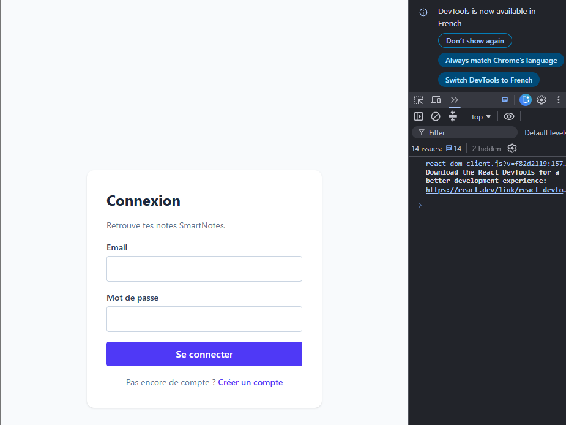
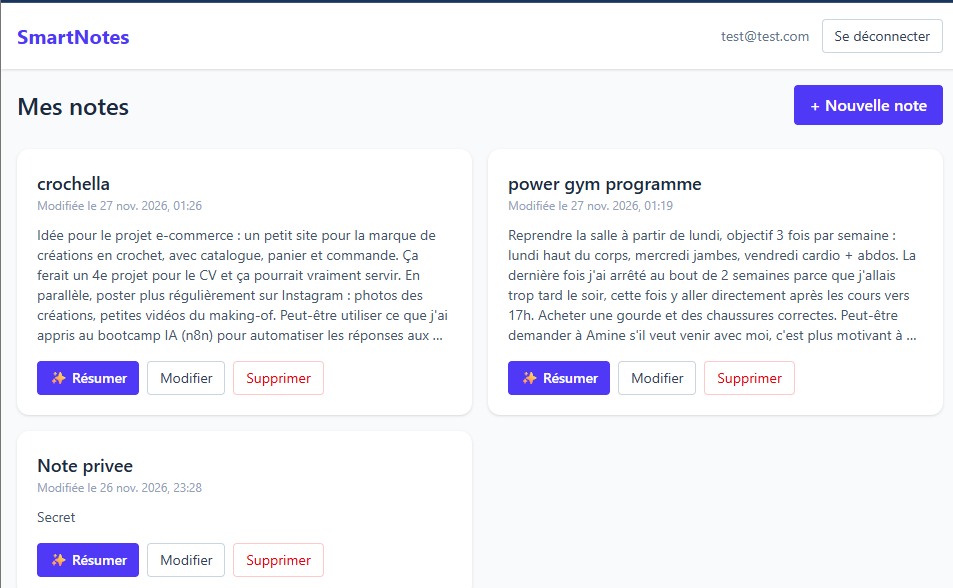
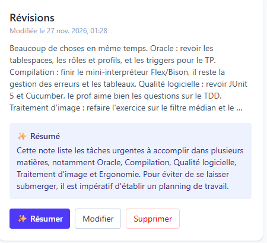
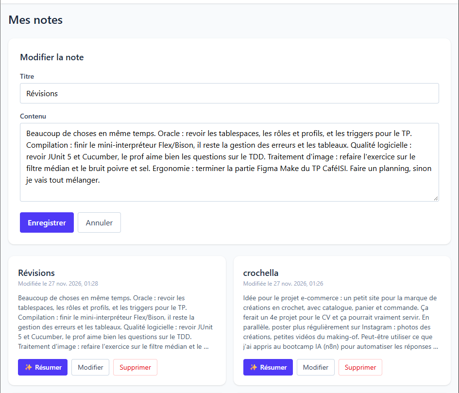

# ✨ SmartNotes

Application web de prise de notes avec **authentification JWT** et **résumé automatique par IA** (Google Gemini).

Projet personnel réalisé pour mon portfolio : un backend Spring Boot sécurisé et un frontend React.

## Fonctionnalités

- **Inscription et connexion** avec JWT (mot de passe haché avec BCrypt)
- **Notes privées** : chaque utilisateur peut créer, voir, modifier et supprimer **ses** notes (titre + contenu). Il n'a jamais accès à celles des autres.
- **Bouton « ✨ Résumer »** : le backend envoie le contenu de la note à l'API Gemini et le résumé s'affiche sous la note.

## Captures d'écran

> À compléter : place tes images dans `docs/screenshots/` avec ces noms.

| Connexion | Mes notes |
|---|---|
|  |  |

| Résumé Gemini | Modification d'une note |
|---|---|
|  |  |

## Technologies

| Partie | Technologies |
|---|---|
| Backend | Java 17, Spring Boot 3, Spring Security, JWT (jjwt), Spring Data JPA, MySQL |
| Frontend | React (Vite), Tailwind CSS, Axios, React Router |
| IA | API Google Gemini, appelée uniquement depuis le backend |

## Architecture

```
smartnotes/
├── backend/    # API REST Spring Boot (port 8081)
│   └── src/main/java/com/smartnotes/
│       ├── config/       # SecurityConfig (règles de sécurité + CORS)
│       ├── security/     # JwtUtil, JwtAuthFilter
│       ├── controller/   # AuthController, NoteController
│       ├── service/      # NoteService, AiService, CustomUserDetailsService
│       ├── repository/   # UserRepository, NoteRepository
│       ├── entity/       # User, Note
│       └── dto/          # objets d'entrée/sortie de l'API
└── frontend/   # Application React (port 5173)
    └── src/
        ├── api/          # instance Axios (ajoute le token JWT automatiquement)
        ├── components/   # NoteCard, NoteForm, ProtectedRoute
        └── pages/        # Login, Register, Dashboard
```

**Fonctionnement de l'authentification :**

1. L'utilisateur se connecte : le backend renvoie un token JWT signé.
2. Le frontend le stocke dans `localStorage`, et Axios l'envoie dans l'en-tête `Authorization: Bearer ...` à chaque requête.
3. `JwtAuthFilter` vérifie le token et identifie l'utilisateur.
4. `NoteService` ne retourne que les notes de cet utilisateur.

## Installation

### Prérequis

- JDK 17 ou plus récent
- Node.js (version récente) et npm
- MySQL 8 ou plus récent, lancé en local sur le port 3306
- Une clé API Gemini gratuite : <https://aistudio.google.com/apikey>

### 1. Cloner le projet

```bash
git clone https://github.com/achrefbelhaj/smartnotes.git
cd smartnotes
```

### 2. Définir les variables d'environnement

Aucun secret n'est écrit dans le code. Le fichier `.env.example` liste les variables à définir :

| Variable | Rôle | Obligatoire |
|---|---|---|
| `DB_PASSWORD` | Mot de passe MySQL | Oui |
| `JWT_SECRET` | Clé de signature des tokens (32 caractères minimum) | Oui |
| `GEMINI_API_KEY` | Clé de l'API Gemini | Pour le bouton Résumer |
| `DB_USERNAME` | Utilisateur MySQL (défaut : `root`) | Non |
| `GEMINI_MODEL` | Modèle Gemini (défaut : `gemini-3.5-flash-lite`) | Non |

**Avec IntelliJ IDEA :** ouvre le dossier `backend`, puis *Run > Edit Configurations > SmartNotesApplication > Environment variables*, et ajoute :

```
DB_PASSWORD=ton_mot_de_passe;JWT_SECRET=une_cle_aleatoire_de_32_caracteres_minimum;GEMINI_API_KEY=ta_cle
```

**Avec PowerShell** (valable pour la session en cours) :

```powershell
$env:DB_PASSWORD = "ton_mot_de_passe"
$env:JWT_SECRET = "une_cle_aleatoire_de_32_caracteres_minimum"
$env:GEMINI_API_KEY = "ta_cle"
```

Pour générer un `JWT_SECRET` :

```powershell
$b = New-Object byte[] 48; [Security.Cryptography.RandomNumberGenerator]::Create().GetBytes($b); [Convert]::ToBase64String($b)
```

### 3. Lancer le backend

La base `smartnotes` et ses tables sont créées automatiquement au premier démarrage.

```powershell
cd backend
.\mvnw.cmd spring-boot:run
```

(Sous Linux ou macOS : `./mvnw spring-boot:run`. Tu peux aussi lancer `SmartNotesApplication` depuis IntelliJ.)

L'API est disponible sur <http://localhost:8081>.

> Le port 8081 est utilisé parce que le 8080 est souvent déjà pris sur certaines machines. Il se change avec `server.port` dans `application.properties`.

### 4. Lancer le frontend

Dans un second terminal :

```bash
cd frontend
npm install
npm run dev
```

Ouvre <http://localhost:5173>, crée un compte, et c'est parti.

Le frontend appelle `http://localhost:8081/api` par défaut. Pour changer cette adresse, définis `VITE_API_URL`.

## API

| Méthode | URL | Description | Authentification |
|---|---|---|---|
| POST | `/api/auth/register` | Créer un compte | Non |
| POST | `/api/auth/login` | Se connecter | Non |
| GET | `/api/notes` | Lister mes notes | Oui |
| GET | `/api/notes/{id}` | Voir une note | Oui |
| POST | `/api/notes` | Créer une note | Oui |
| PUT | `/api/notes/{id}` | Modifier une note | Oui |
| DELETE | `/api/notes/{id}` | Supprimer une note | Oui |
| POST | `/api/notes/{id}/summarize` | Résumer une note avec Gemini | Oui |

## Sécurité : ce qui est en place

- Mots de passe hachés avec **BCrypt**, jamais stockés en clair.
- API **stateless** : pas de session, chaque requête porte son token JWT.
- **Isolation des utilisateurs** : les notes sont toujours recherchées avec l'email de l'utilisateur connecté, lu dans le token. Lire, modifier ou supprimer la note d'un autre renvoie une erreur 404.
- **Secrets hors du code** : mot de passe MySQL, secret JWT et clé Gemini viennent de variables d'environnement.
- La **clé Gemini reste côté serveur** : elle n'est jamais envoyée au navigateur.
- Les DTO évitent d'exposer l'entité `User` (et son mot de passe haché).

## Limites connues et pistes d'amélioration

- Le token JWT est stocké dans `localStorage` : simple, mais exposé en cas de faille XSS. Une amélioration serait un cookie `HttpOnly`.
- Pas de refresh token : le token expire après 24 h et l'utilisateur doit se reconnecter.
- `spring.jpa.hibernate.ddl-auto=update` convient au développement ; en production, on utiliserait des migrations (Flyway).
- Pas de tests automatisés, ni de Docker (choix volontaire pour garder le projet simple).
- Avec l'offre gratuite de Gemini, le contenu envoyé peut servir à améliorer les produits de Google : ne mets pas de données sensibles dans les notes.


